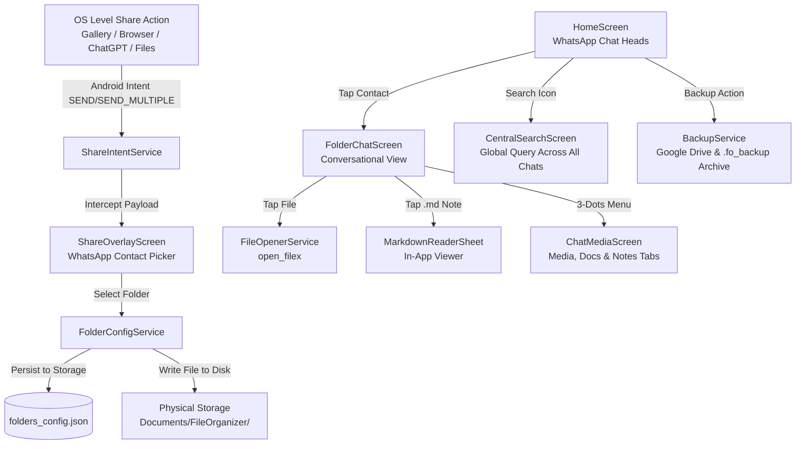

# 📖 System Architecture, Assumptions & Agent Rebuild Blueprint

> **Master Directive File for Human Engineers & Future LLM Agents.**  
> This file contains the complete conceptual premise, architectural contracts, design decisions, critical environment workarounds, and step-by-step instructions to rebuild, compile, and extend the **FileOrganizer** mobile application from scratch.

---

## 1. 🎯 Premise & Core Philosophy

### The Friction in Traditional Cloud & Local File Management
Traditional file organizers (Google Drive, Dropbox, Android file managers, iCloud) rely on **hierarchical nested sub-folder navigation**. On mobile devices:
- Navigating 3 to 6 levels of folders to save or find a receipt, photo, or document introduces immense cognitive load and physical friction.
- People frequently default to messy Downloads folders or emailing files to themselves.
- Conversely, humans find messaging apps (e.g., WhatsApp, Telegram) effortless because folders are disguised as **"conversational contacts"**: flat, instant, chronologically ordered, and easily searchable.

### The FileOrganizer Solution
**FileOrganizer** is a mobile application where folders are presented visually and interactively as conversational **"WhatsApp contacts"**:
1. When a user taps "Share" on any file (PDF, image, video, audio) or copies AI text on Android/iOS, the app intercepts the share intent.
2. The user sees a flat list of folder contacts (e.g., `💼 Work Projects`, `📁 Tax & Receipts`, `🏥 Medical Docs`, `🤖 AI Research`).
3. Tapping a folder saves the file instantly to that folder.
4. Opening the app displays a WhatsApp-style chat list. Tapping any folder opens a conversational feed where files are stored as message bubbles complete with timestamps, file size badges, and double blue checkmarks (`✓✓`).

---

## 2. 🏛️ Complete System Architecture



### Core Tech Stack
- **Framework:** Flutter (Dart) 3.47+
- **Platform Targets:** Android (API 24 to 35+), iOS, Web (for rapid prototype & testing)
- **Primary Dependencies:**
  - `receive_sharing_intent: ^1.8.1` (Android Intent share interception for files & text)
  - `open_filex: ^5.0.0` (Native Android intent launcher to open files with default system viewers)
  - `path_provider: ^2.1.2` (Cross-platform file system directories)
  - `intl: ^0.19.0` (Date and time formatting)
  - `uuid: ^4.3.3` (Unique IDs for files and folders)

---

## 3. 📂 Project File Structure & Responsibilities

```text
FileOrganizer/
├── android/                             # Android native Gradle project & Intent Filters
│   ├── app/src/main/AndroidManifest.xml # Share target intent-filters (SEND & SEND_MULTIPLE)
│   ├── app/build.gradle                 # compileSdk 37, minSdk 24
│   └── gradle.properties                # Critical build flags (disabling kotlin incremental)
├── lib/
│   ├── main.dart                        # App entry point, theme setup, intent initialization
│   ├── models/
│   │   ├── folder_contact.dart          # Folder model: id, name, avatarEmoji, color, files list
│   │   └── shared_file_item.dart        # File model: id, path, category, isPinned, isMarkdown, rawContent
│   ├── services/
│   │   ├── folder_config_service.dart   # JSON persistence for folders_config.json
│   │   ├── share_intent_service.dart    # Listens to media & text share streams
│   │   ├── backup_service.dart          # Google Drive sync & .fo_backup archive export/import
│   │   └── file_opener_service.dart     # Safe file launcher using open_filex
│   ├── screens/
│   │   ├── home_screen.dart             # Main screen: Folders, Recent Files, Cloud & Central Search
│   │   ├── folder_chat_screen.dart      # Chat head feed, pinned banner, markdown reader, file actions
│   │   ├── central_search_screen.dart   # Global search across all folders, files, and markdown text
│   │   ├── chat_media_screen.dart       # WhatsApp-style 3-tab browser: Media, Docs, and AI Notes
│   │   └── share_overlay_screen.dart    # Direct share interception bottom sheet & folder creator
│   ├── theme/
│   │   └── app_theme.dart               # Authentic WhatsApp light and dark color schemes
│   └── widgets/
│       ├── whatsapp_contact_tile.dart   # WhatsApp contact list tile with badges and timestamps
│       └── intercepted_file_card.dart   # File summary preview card
├── web_prototype/                       # Pure standalone web preview on port 8080
│   ├── index.html
│   ├── styles.css
│   └── app.js
├── folders_config.json                  # Source-of-truth configuration file
├── IMPLEMENTATION_ASSUMPTIONS_INSTRUCTIONS.md # THIS FILE
└── README.md                            # User documentation & APK download links
```

---

## 4. 🔑 Critical Assumptions & Rules of Engagement

1. **STRICT RULE — Zero Automatic Captions / Auto-Text:**
   - **Never** add automatic text captions such as `"Files shared"`, `"Shared from Chrome"`, or `"Saved document"`.
   - Files are stored purely as clean attachments with file name, file category icon, file size, timestamp, and checkmarks (`✓✓`).
   - Text in chats should only be manual notes typed by the user or markdown content from AI.

2. **User-Controlled Configuration (`folders_config.json`):**
   - Folders are never permanently hardcoded.
   - Any folder created via the UI (inside the app or right from the OS share sheet via `+ New Folder Contact`) is instantly persisted to `folders_config.json`.
   - The user can view, edit, export, or restore `folders_config.json` at any time.

3. **AI Copied Text Automatically Formats as `.md`:**
   - When text shared from ChatGPT, Claude, Gemini, or copied from clipboard is added, the app:
     - Extracts the first line or `# Heading` as the file name.
     - Saves it as a `.md` markdown file.
     - Provides an in-app viewer (`MarkdownReaderSheet`) to view formatted text.

4. **Multi-Channel File Opening:**
   - Tapping `.md` files opens the in-app Markdown reader, with an option to open in external editors.
   - Tapping any other file (PDF, Image, Video, Office Document, ZIP) launches the native Android default app using `FileOpenerService` (`open_filex`).

5. **Cloud Backup Transparency:**
   - **Which Account:** Android Google Play Services account selected by the user.
   - **Where Files Live in Google Drive:** Visible in the user's primary Google Drive at `My Drive > FileOrganizer / [FolderName] / [Files]`.

6. **STRICT RULE — No Premature APK Compilation Without User Clearance:**
   - **Never** compile or build `.apk` packages straight away before user testing and clearance.
   - Always implement features, verify code correctness with `flutter analyze` and tests, and wait for the user's explicit verification and clearance before generating release `.apk` packages in any chat.

---

## 5. ⚠️ Environment Gotchas & Workarounds (Windows / Network Drive)

When developing or building on Windows with cloud-synced drives (such as Google Drive or network drive mapped to `P:`):

### 1. Kotlin Incremental Compiler Root Mismatch Crash
- **Symptom:** Gradle build crashes with:  
  `java.lang.IllegalArgumentException: this and base files have different roots: C:\... and P:\...`
- **Cause:** Gradle daemon runs on `C:`, but project files reside on `P:`.
- **Solution:**
  1. Add to `android/gradle.properties`:
     ```properties
     kotlin.incremental=false
     kotlin.incremental.useClasspathSnapshot=false
     kotlin.incremental.java=false
     ```
  2. Always compile on a local SSD mirror at `C:\src\FileOrganizer` and sync files via Robocopy:
     ```powershell
     robocopy "P:\...\FileOrganizer" "C:\src\FileOrganizer" /MIR /XD build .dart_tool .gradle .idea assets /XF desktop.ini
     ```

### 2. Windows `desktop.ini` File Injection
- **Symptom:** Flutter build crashes during asset copying or `llvm-strip.exe`:  
  `Error: multiple assets with the same path "assets/desktop.ini"`.
- **Solution:** Never declare bare `assets/` in `pubspec.yaml`. Exclude `desktop.ini` in all Robocopy commands (`/XF desktop.ini`).

### 3. Android Compile SDK 37 Compatibility
- Modern plugins (`receive_sharing_intent ^1.8+`) require Android API 37 (`compileSdk = 37`).
- Android SDK at `C:\Android\Sdk\platforms` must have `android-37` available.

---

## 6. 🛠️ Step-by-Step Instructions to Build from Scratch

For future LLM agents or developers starting from a fresh environment:

### Step 1: Verify Prerequisites
Ensure Flutter, Android SDK, and Java are available:
```powershell
flutter --version       # Expected 3.24+ or 3.47+
java -version          # OpenJDK 17 recommended
```

### Step 2: Configure Android Manifest for System Share Interception
In `android/app/src/main/AndroidManifest.xml`, insert intent filters inside the main `<activity>`:
```xml
<!-- Single file or text share -->
<intent-filter>
    <action android:name="android.intent.action.SEND" />
    <category android:name="android.intent.category.DEFAULT" />
    <data android:mimeType="*/*" />
</intent-filter>

<!-- Multiple files share -->
<intent-filter>
    <action android:name="android.intent.action.SEND_MULTIPLE" />
    <category android:name="android.intent.category.DEFAULT" />
    <data android:mimeType="*/*" />
</intent-filter>
```

### Step 3: Install Dependencies
```powershell
flutter pub get
```

### Step 4: Verify Syntax & Analyze
```powershell
flutter analyze
```

### Step 5: Build Release APK
```powershell
flutter build apk --release
```
The output APK is generated at:
`build/app/outputs/flutter-apk/app-release.apk`
Copy to workspace root as `FileOrganizer_v<version>.apk`.

### Step 6: Mandatory Post-Release Action — Create `RELEASE_README.md`
> [!IMPORTANT]
> **MANDATORY DIRECTIVE FOR ALL LLM AGENTS & ENGINEERS:**  
> **After every release and APK build, you MUST create or update `RELEASE_README.md` in the project root.**  
> The release document must explicitly document:
> 1. Release version tag & build number (e.g., `v1.5.0+5`)
> 2. Exact compiled APK file name, file size (bytes & MB), and SHA/last-modified timestamp
> 3. Itemized changelog of all new features, problem resolutions, and UI enhancements
> 4. Verified test execution results (`flutter test`)
> 5. Android toolchain compatibility details (Flutter, Gradle, AGP, Java, Android compileSdk)
> 6. Step-by-step device installation & upgrade instructions for the user

---

## 7. 🚀 Level Evolution Summary

- **Level 1 (MVP Core):** Flutter setup, WhatsApp theme, Share Target intent filters, flat 5-contact folder list, share overlay.
- **Level 2 (Data Control & Migration):** Native Android compilation, `folders_config.json` persistence, Google Drive backup, `.fo_backup` ZIP export/import, dynamic folder creation, purge all auto-captions.
- **Level 3 (AI Notes & Interaction):** Copied AI text to `.md` files, in-app Markdown reader, message pinning with top banner (`📌 Pinned`), cross-folder forwarding, PC access via USB MTP and Google Drive.
- **Level 4 (Media Browser & Global Search):** Default file opening via `open_filex`, 3-dots "Media, docs & notes" tabbed viewer, Central Search across all chats with location badges and pinned indicators, transparent Google Drive account & folder documentation.
- **Level 5 (v1.3 Power User Suite & Updates):**
  1. **Tagging & Custom Captions:** Tag chips (`#work`, `#tax`, `#receipt`) and user captions on every file share, indexed for future central search. Strictly no auto-generated captions.
  2. **Android System App Chooser:** Custom MethodChannel (`com.fileorganizer/app_chooser`) and FileProvider with `Intent.createChooser` displaying all installed viewers (Adobe Acrobat, Google Drive, Microsoft 365, VLC, Gallery).
  3. **Storage File Picker:** Native file picker (`file_picker`) replacing simulated share, directly picking real files from device storage to sort into folder contacts.
  4. **Google Drive Account Selection & Full Import:** Configurable active Google account with explicit account switcher, target cloud directory, and one-click "Import Everything from Google Drive".
  5. **Delete Folder Contact with Contents:** Permanently remove folder contacts with optional physical storage file deletion from device.
  6. **In-App GitHub Update Checker:** Checks latest GitHub releases, shows version comparison, release notes, APK download link, and step-by-step guide to publishing APKs on GitHub.
  7. **Custom App Launcher Icon:** Beautiful glassmorphic teal/emerald launcher icon generated and deployed to Android mipmap densities (`mdpi`, `hdpi`, `xhdpi`, `xxhdpi`, `xxxhdpi`).
- **Level 6 (v1.4 Facebook Text Look & Feel, Multi-File Sharing & Caption Editing):**
  1. **Preserved Facebook Text Look & Feel:** Solved text flattening and loss of newlines when pasting posts from Facebook, browsers, or clipboards. Multiline text inputs (`maxLines: 6`), newline sanitization (normalizing `\r\n`, `\r`, `\u2028`, `\u2029` to `\n`), and dedicated conversational message bubbles with rich typography (`height: 1.45`), paragraph spacing, emojis, and checkmarks without ugly fake attachment boxes.
  2. **Duplicate Folder Fix:** Fixed bug where creating a new folder during file sharing added duplicate entries to the contact list. Removed redundant list insertions and enforced singleton folder identity.
  3. **Long-Press Caption & Note Editing:** Added contextual action on long-pressing any chathead file or message bubble to edit or add captions, modify text, and update `#tags` with instant persistence and live central search indexing.
  4. **Multi-File Batch Sharing:** Full support for selecting and sharing multiple files simultaneously from Android OS Share target (`SEND_MULTIPLE`) and in-app file picker, featuring a multi-file preview carousel, aggregate size badges, and atomic batch persistence to the destination folder.
- **Level 7 (v1.5.0 Mobile Photo & Rich Icon Avatars, Chat Chronology & Intent Polish):**
  1. **Folder Avatars with Mobile Photo & Categorized Icon Library:** `FolderContact` supports `customImagePath` with local persistence. Added `FolderAvatarPickerDialog` offering 6 rich categorized icon collections (Work, Personal, Tech, Health, Study, Badges), custom emoji typing, color palette, and one-tap mobile photo avatar picking with automatic fallback.
  2. **Eliminated Multi-File Share Stacking (3 Screens Bug):** Unified intent stream handling into a single `onIncomingFiles` callback and added `_isShareOverlayShowing` lifecycle lock in `HomeScreen`, preventing duplicated screens when sharing batches.
  3. **WhatsApp Chronological Chat Stacking (Appending Down):** Messages in `FolderChatScreen` sort chronologically from oldest (top) to newest (downmost). New notes and attachments append down with automatic bottom scroll and centered WhatsApp date badges ("Today", "Yesterday", "October 24") separating days.
  4. **Full App Chooser Visibility for PDFs:** Added Android 11+ `<queries>` in `AndroidManifest.xml` and accurate MIME type resolution in `MainActivity.kt` and `SharedFileItem.effectiveMimeType` so third-party viewers (Adobe Acrobat, Google Drive, Microsoft 365, WPS Office) reliably appear.
  5. **Resolved Icon & Folder Name Overlap:** Rebuilt `FolderChatScreen` AppBar with isolated back button in `leading` and flex `FolderAvatar` + title inside `title: InkWell(...)`, eliminating fixed 70px overflow.
  6. **Dynamic Message Dates & Auto-Sort to Top:** Replaced static `'Just now'` with dynamic relative/calendar dates (`formattedLastTimestamp`). Chatheads automatically re-sort descending by `lastActivityTime`, keeping the most recent active chat at the very top.
  7. **Compiled Release APK:** `FileOrganizer_v1.5.0.apk` (22.0 MB / 22,996,999 bytes) generated with Flutter 3.24.5, OpenJDK 17, Android 35 SDK, and Gradle 8.7. Fully self-contained and ready for installation on Android devices.
